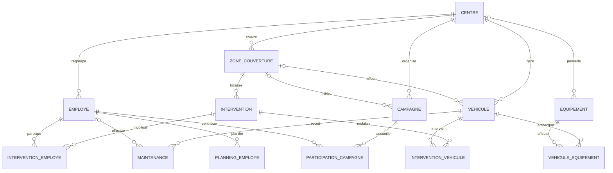

# Modèles de données — Fire Station (S5)

Ce document traduit les six modules du cahier des spécifications en modèle conceptuel puis relationnel. Le modèle physique Oracle se trouve dans [`../database/oracle_schema.sql`](../database/oracle_schema.sql).

## Modules retenus

| Module | Données principales | Fonctions attendues |
|---|---|---|
| Employés et authentification | Identité, centre, grade, spécialité, contacts, hash du mot de passe | CRUD, recherche/filtre, planning et authentification |
| Véhicules | Immatriculation, type, état, zone, kilométrage, dates d’entretien | CRUD, recherche, tri, export, statistiques, alertes préventives et recommandation |
| Équipements | Catégorie, désignation, quantité, état, contrôle, expiration, affectation | CRUD, recherche, tri, export, statistiques, alertes de stock/expiration et affectation aux véhicules |
| Interventions | Type, adresse, date/heure, priorité, état, zone | CRUD, recherche, tri, export, statistiques, affectation d’agents et de véhicules |
| Campagnes de sensibilisation | Titre, thème, date, lieu, public, participants, impact | CRUD, recherche, tri, export, statistiques et ciblage des zones à risque |
| Zones couvertes | Nom, région/quartier, superficie, population, risque, délai moyen | CRUD, recherche, tri, export, statistiques et alertes de couverture |

Les utilisateurs finaux correspondent aux employés disposant d’un compte. `MOT_DE_PASSE_HASH` contient uniquement un hash produit par une bibliothèque de hachage adaptée ; aucun mot de passe en clair ne doit être stocké.

## Modèle Entité / Association

`o|` indique une association facultative du côté concerné. Les associations plusieurs-à-plusieurs sont matérialisées par les tables d’association `VEHICULE_EQUIPEMENT`, `INTERVENTION_EMPLOYE`, `INTERVENTION_VEHICULE` et `PARTICIPATION_CAMPAGNE`.

## Modèle relationnel

- **CENTRE**(**ID_CENTRE**, NOM, ADRESSE, TELEPHONE)
- **ZONE_COUVERTURE**(**ID_ZONE**, ID_CENTRE FK, NOM, REGION_QUARTIER, SUPERFICIE_KM2, POPULATION_ESTIMEE, NIVEAU_RISQUE, TEMPS_MOYEN_REPONSE_MIN)
- **EMPLOYE**(**ID_EMPLOYE**, ID_CENTRE FK, NOM, PRENOM, GRADE, SPECIALITE, TELEPHONE, EMAIL UQ, MOT_DE_PASSE_HASH, ACTIF)
- **VEHICULE**(**ID_VEHICULE**, ID_CENTRE FK, ID_ZONE FK nullable, IMMATRICULATION UQ, TYPE_VEHICULE, MODELE, ETAT, KILOMETRAGE, DATE_MISE_EN_SERVICE, DATE_DERNIERE_MAINTENANCE, DATE_PROCHAINE_MAINTENANCE, KM_PROCHAINE_MAINTENANCE, NOTES)
- **MAINTENANCE**(**ID_MAINTENANCE**, ID_VEHICULE FK, ID_EMPLOYE_RESPONSABLE FK nullable, DATE_MAINTENANCE, TYPE_MAINTENANCE, KILOMETRAGE, DESCRIPTION, COUT, PROCHAINE_ECHEANCE)
- **EQUIPEMENT**(**ID**, ID_CENTRE FK nullable, NOM, TYPE_EQUIP, QUANTITE, DATE_ACQUISITION, ETAT, DATE_CONTROLE, AFFECTATION, SEUIL_ALERTE, DATE_EXPIRATION)
- **VEHICULE_EQUIPEMENT**(**ID_VEHICULE** FK, **ID_EQUIPEMENT** FK, **DATE_AFFECTATION**, QUANTITE_AFFECTEE, DATE_RETRAIT)
- **INTERVENTION**(**ID_INTERVENTION**, ID_ZONE FK, TYPE_INTERVENTION, ADRESSE, DATE_HEURE, PRIORITE, STATUT, DESCRIPTION, LATITUDE, LONGITUDE)
- **INTERVENTION_EMPLOYE**(**ID_INTERVENTION** FK, **ID_EMPLOYE** FK, ROLE_INTERVENTION)
- **INTERVENTION_VEHICULE**(**ID_INTERVENTION** FK, **ID_VEHICULE** FK)
- **CAMPAGNE**(**ID_CAMPAGNE**, ID_CENTRE FK, ID_ZONE FK nullable, TITRE, THEME, DATE_CAMPAGNE, LIEU, PUBLIC_CIBLE, NB_PARTICIPANTS, IMPACT_OBSERVE)
- **PARTICIPATION_CAMPAGNE**(**ID_CAMPAGNE** FK, **ID_EMPLOYE** FK, ROLE_PARTICIPATION)
- **PLANNING_EMPLOYE**(**ID_PLANNING**, ID_EMPLOYE FK, DATE_DEBUT, DATE_FIN, TYPE_SERVICE, NOTES)

`PK` est la clé primaire, `FK` une clé étrangère, `UQ` une contrainte d’unicité. Les PK composites des tables d’association empêchent l’enregistrement en double de la même association.

## Remarques d’implémentation

- Le script SQL est compatible Oracle XE 11g : des séquences et triggers génèrent les identifiants, avec des types `DATE`, des contraintes de domaine et des index destinés aux recherches et alertes.
- La table `EQUIPEMENT` conserve les champs utilisés par le module Qt existant et ajoute le centre et l’expiration pour le modèle commun.
- Le prototype intégré actuel contient les pages Qt Véhicules, Équipements et Interventions. Employés, zones, campagnes et planning sont documentés et présents dans le schéma commun ; leurs écrans CRUD ne sont pas encore implémentés dans ce prototype.
- Le pilote Oracle utilisé par Qt est `QODBC`. Le serveur Oracle et le pilote ODBC natif doivent être installés sur le poste avant de pouvoir valider une connexion Oracle réelle.
